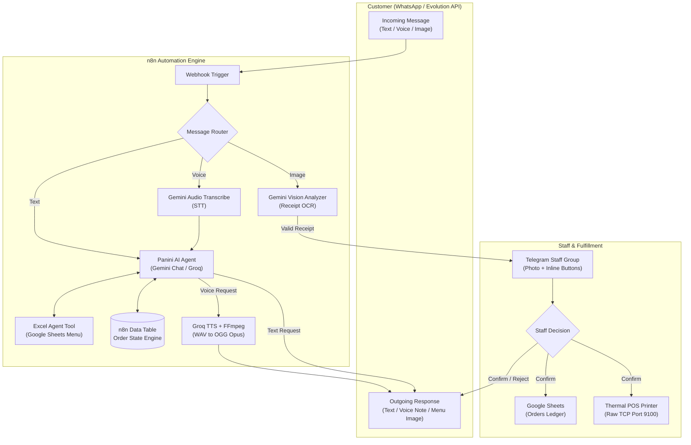

# Panini Restaurant AI Assistant (`Restaurant_P`)

> An intelligent, end-to-end restaurant ordering and payment automation system built with **n8n**, **Google Gemini 3 Flash**, and **Groq**. Fully integrates with **WhatsApp (Evolution API)**, **Telegram Staff Operations**, **Google Sheets**, and **Network Thermal POS Receipt Printers (Port 9100)**.


-25D366?style=for-the-badge&logo=whatsapp&logoColor=white)


---

## Overview

**Restaurant_P** is an autonomous conversational AI agent designed for restaurants to handle complete customer lifecycles on **WhatsApp** using natural Egyptian Arabic dialogue. 

### Core Capabilities:
1. **Multimodal Customer Interaction**: Supports text, voice notes (STT + TTS), and image/receipt recognition.
2. **Dynamic Menu Lookups**: Queries live Google Sheets data via an AI tool to prevent hallucinations of items, sizes, or prices.
3. **Automated Menu Dispatch**: Sends a high-resolution menu photo only when explicitly requested.
4. **Automated Payment & OCR Validation**: Validates digital transfers (InstaPay, Vodafone Cash, Bank transfers) using computer vision.
5. **Staff Order Verification**: Dispatches pending orders with receipt screenshots directly to a Telegram management channel with interactive action buttons (`Confirm` / `Reject`).
6. **Automatic POS Kitchen Printing**: Sends raw print jobs directly over TCP (Port 9100) to thermal receipt printers upon approval.
7. **Sheets Ledger Sync**: Logs confirmed transactions to Google Sheets for inventory and accounting.
8. **Periodic Follow-up Monitoring**: Scans every minute for orders awaiting review for more than 5 minutes and nudges staff.

---

## System Architecture



---

## Order State Machine

The order lifecycle is tracked via an internal **n8n Data Table**:

```
[collecting] --(Customer uploads receipt)--> [awaiting_staff] --(Staff Confirms)--> [confirmed] (Printed + Logged)
                                                    |
                                                    +--(Staff Rejects)---> [rejected] (Customer Notified)
```

| Status | Description | Trigger / Outcome |
| :--- | :--- | :--- |
| `collecting` | Agent is assembling cart items, delivery address, phone, and total price. | Saved via `Save_Order_Details` tool. |
| `awaiting_staff` | Customer submitted a verified transfer receipt screenshot. | Sent to Telegram with inline buttons; customer is notified. |
| `confirmed` | Staff clicked `Confirm` in Telegram. | Added to Google Sheets, sent to printer, customer notified via WhatsApp. |
| `rejected` | Staff clicked `Reject` in Telegram. | Customer alerted with follow-up instructions. |

---

## Multimodal & AI Tech Stack

- **Large Language Models**:
  - `models/gemini-3-flash-preview`: Audio transcription (STT), receipt OCR/Vision analysis, and primary LangChain chat agent.
  - `qwen/qwen3.8-27b` & `openai/gpt-oss-20b` (via Groq): Fallback conversational intelligence and dedicated menu query agent.
- **Voice Synthesis (TTS)**:
  - Groq Audio Speech API (`canopylabs/orpheus-v1-english` / voice `troy`).
  - Native `ffmpeg` command node converting output `.wav` to WhatsApp-compatible voice note format (`-c:a libopus -b:a 64k -ar 16000 -ac 1 output.ogg`).
- **Vision Extraction Rules**:
  - Verifies screenshots against InstaPay, Vodafone Cash, or bank transfers.
  - Extracts numeric amount and transaction method into a strict JSON payload.

---

## Prerequisites

Before importing and running the workflow, make sure you have:

1. **n8n Instance** (v1.x+ with LangChain and Data Table support enabled).
2. **WhatsApp Gateway**: [Evolution API](https://github.com/EvolutionAPI/evolution-api) instance connected to the restaurant's phone number.
3. **Telegram Bot**:
   - Bot token created via [@BotFather](https://t.me/BotFather).
   - Staff group/channel `Chat ID`.
4. **Google Cloud Platform**:
   - Enabled Google Sheets API with OAuth2 credentials connected in n8n.
5. **API Keys**:
   - Google Gemini API Key.
   - Groq API Key.
6. **Host Dependencies**:
   - `ffmpeg` installed on the host or inside the n8n Docker container.
7. **ESC/POS Thermal Receipt Printer**:
   - Network printer reachable via IP/Port 9100 (or the included Node.js mock server).

---

## Configuration & Placeholders

Search and replace the following placeholder values in the workflow JSON before deployment:

| Placeholder | Description | Associated Node |
| :--- | :--- | :--- |
| `YOUR_WEBHOOK_PATH` | The webhook endpoint URL configured in Evolution API | `Webhook` |
| `YOUR_EVOLUTION_API_KEY` | Header authentication key for Evolution API | Evolution API nodes & HTTP Request |
| `YOUR_TELEGRAM_CHAT_ID` | Telegram chat ID for restaurant staff/cashier group | Telegram notification nodes |
| `YOUR_MENU_SHEET_ID` | Google Spreadsheet ID containing the menu and prices | `Get Items Sheets` |
| `YOUR_ORDERS_SHEET_ID` | Google Spreadsheet ID for logging confirmed orders | `Append to Orders Sheet` |
| `YOUR_MENU_IMAGE_DRIVE_ID` | Google Drive public ID of the menu image | `Send_Menu_Image` tool |
| `YOUR_DATA_TABLE_ID` | The ID of the n8n Data Table created for order states | All `dataTable` and `dataTableTool` nodes |
| `YOUR_INSTAPAY_ADDRESS` | Official InstaPay address for the restaurant | `AI Agent` system prompt |
| `YOUR_INSTAPAY_PAYMENT_LINK`| Direct InstaPay payment link | `AI Agent` system prompt |
| `YOUR_PHONE_NUMBER` | Vodafone Cash wallet / support phone number | `AI Agent` system prompt |

---

## n8n Data Table Schema

Create a Data Table in n8n named `restaurant_orders` with the following column definitions:

| Column Name | Data Type | Purpose |
| :--- | :--- | :--- |
| `wa_instance` | `String` | WhatsApp instance identifier |
| `wa_number` | `String` | Customer WhatsApp phone number |
| `customer_name`| `String` | Full name of the customer |
| `order_text` | `String` | Ordered items, sizes, quantities, and notes |
| `total_price` | `String` | Calculated total amount |
| `address` | `String` | Delivery destination |
| `phone` | `String` | Primary contact number |
| `alt_phone` | `String` | Optional alternative contact number |
| `payment_method`| `String` | `instapay` or `vodafone_cash` |
| `status` | `String` | `collecting`, `awaiting_staff`, `confirmed`, `rejected` |
| `order_code` | `String` | Unique code (e.g., `P-0042`) |
| `payment_file_id`| `String` | Telegram file ID for the payment receipt |
| `awaiting_since`| `DateTime` | Timestamp when receipt was handed over to staff |
| `reminder_sent` | `Boolean` | Flag indicating if the 5-minute reminder fired |

---

## Mock Thermal Printer Server

For testing raw TCP socket printing without physical hardware, run this lightweight Node.js mock server:

### 1. Save as `printer-mock.js`:
```javascript
const net = require('net');

const PORT = 9100;
const HOST = '0.0.0.0';

const server = net.createServer((socket) => {
  const chunks = [];
  
  socket.on('data', (chunk) => chunks.push(chunk));
  
  socket.on('end', () => {
    const rawData = Buffer.concat(chunks);
    const receiptText = rawData.toString('utf8').replace(/[\x00-\x08\x0B-\x1F]/g, '');
    
    console.log('\n========================================');
    console.log('NEW ORDER RECEIVED FOR PRINTING:');
    console.log('========================================');
    console.log(receiptText);
    console.log('========================================\n');
  });

  socket.on('error', (err) => {
    console.error('Socket error:', err.message);
  });
});

server.listen(PORT, HOST, () => {
  console.log(`Mock Thermal Printer running on port ${PORT}...`);
});
```

### 2. Start the Server:
```bash
node printer-mock.js
```

> **Docker Tip**: If n8n runs inside Docker, the workflow communicates with the host machine using `host.docker.internal:9100`.

---

## Deployment Steps

1. **Import Workflow**:
   - In n8n, navigate to **Workflows** -> **Import from File / JSON**.
   - Paste the `Restaurant_P.json` workflow file.
2. **Configure Credentials**:
   - Google Gemini API (`Google Gemini(PaLM) Api account`).
   - Groq API (`Groq account`).
   - Telegram Bot API (`Telegram account`).
   - Evolution API (`Evolution API account` & Bearer Header Auth).
   - Google Sheets (`Google Sheets account` OAuth2).
3. **Setup Tables & Sheets**:
   - Create the n8n Data Table using the schema above.
   - Prepare the Google Sheets for Menu and Order logging.
4. **Test the Pipeline**:
   - Start your Evolution API instance and trigger the webhook with a test message.
   - Test sending a voice note, asking for the menu, ordering items, and uploading a dummy receipt screenshot.
5. **Activate**:
   - Turn the workflow toggle to **Active**.

---

## Author

- **Muhammad Alaasar** - [eng.mo.alaasar@gmail.com](mailto:eng.mo.alaasar@gmail.com)
